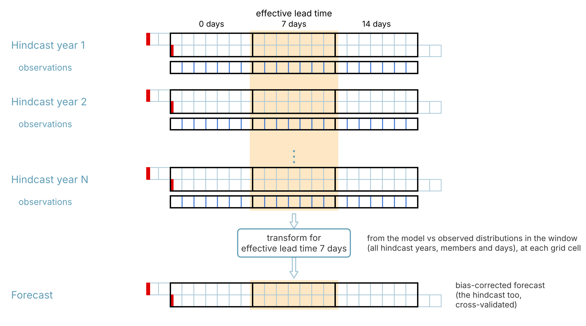
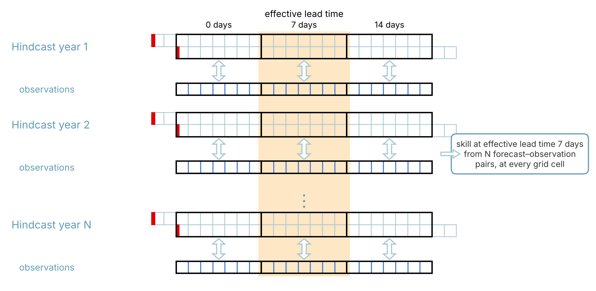
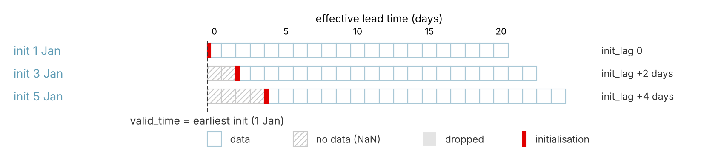
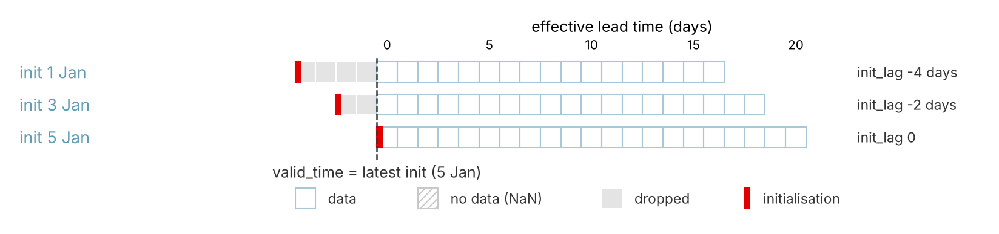
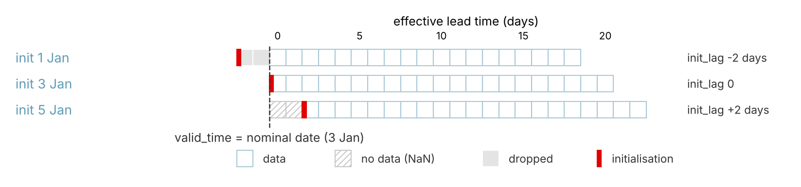
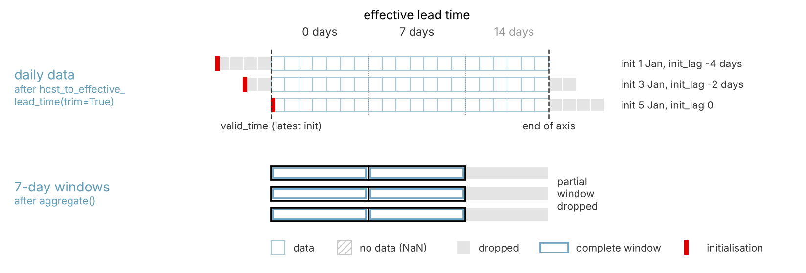
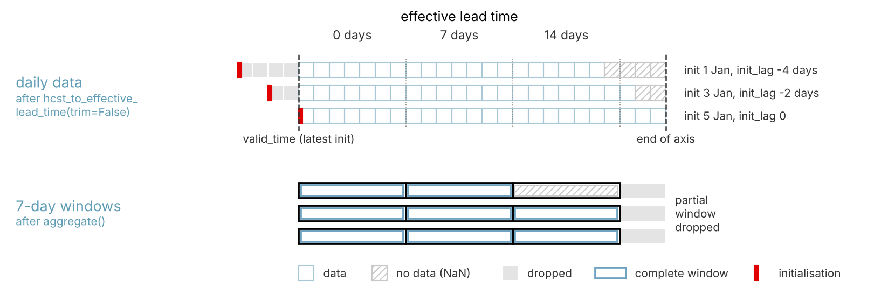
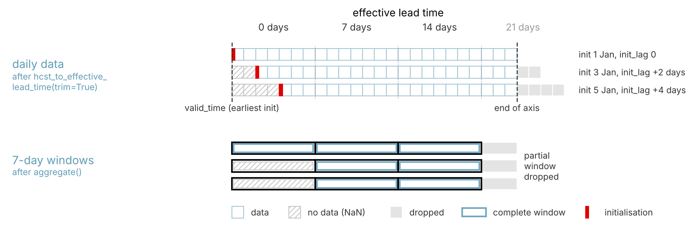
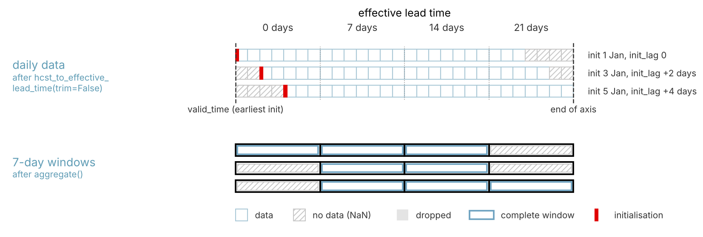
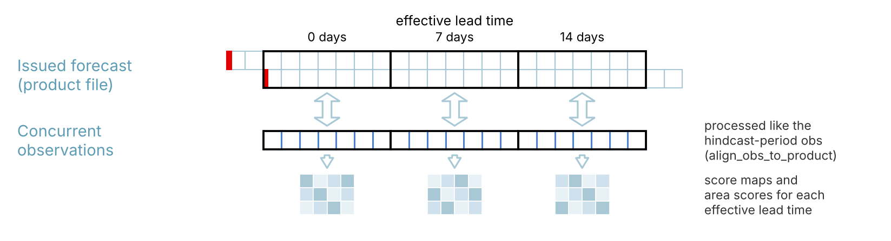

Postprocessing, bias correction and evaluation framework
========================================================

Why an "open-ended" postprocessing framework?
---------------------------------------------

Downloaded data come in a format that is not particularly convenient for further
processing. The general path from data to product is:

#. download data;
#. bias correction against observations;
#. derivation of forecast products;
#. evaluation of hindcast skill against observations;
#. verification of a single forecast against observations.

The general problem
~~~~~~~~~~~~~~~~~~~

- At lead times longer than those of weather forecasts, skill is present in multi-day
  aggregates, not at the daily time scale.
- Biases depend on lead time, so bias correction should be done on a lead-time basis.
- Skill and verification have to be evaluated on a valid-time basis.
- Skill increases with ensemble size, particularly at longer lead times, but hindcasts
  have small ensembles.
- There is therefore a benefit in creating lagged ensembles (ensembles composed of
  ensembles started on different initialisation dates), both for the hindcast and the
  forecast.
- Working with lagged ensembles, however, requires choices about how to "stitch" the
  ensembles together for forecasting, bias correction and evaluation.

Two approaches are possible:

#. **Bias correction of each initialisation in lead time, then combination in valid
   time.** The members of each initialisation are bias-corrected separately, as a
   function of their own lead time (in multi-day lead-time windows), against the
   corresponding observations. Issuing the forecast and evaluating hindcast skill then
   require combining the bias-corrected members of the different initialisations in
   valid time, i.e. across their different lead times. Consequently, bias correction can
   only be done at the daily time scale: multi-day aggregates of initialisations started
   on different days cover different periods, so they cannot be combined in valid time.

   This approach is the most sound from the bias correction perspective, since every
   member is corrected for the bias at its own lead time. However:

   - bias correction at the daily time scale does not guarantee that the multi-day
     aggregates derived from the corrected data are free of bias;
   - each transform is derived from the members of a single initialisation only, i.e.
     from a smaller sample than the whole lagged ensemble;
   - it does not address the combination of members with different skill: skill changes
     with lead time, not with valid time, so the members of earlier initialisations, at
     longer lead times, are generally less skilful than those of the latest one.

#. **Combination in valid time, then bias correction of the "effective" ensemble.** The
   lagged ensemble is first combined in valid time into an "effective" ensemble, and this
   ensemble is bias-corrected against observations, either on daily data or on multi-day
   aggregates created in valid time. Correcting the aggregates directly removes their
   bias, and each transform is derived from the members of all initialisations, i.e.
   from a larger sample.

   However, the "effective" ensemble and its aggregates are composed of individual
   simulations with different initialisation dates, and thus different lead times, and
   consequently different bias and skill. The transform corrects the distribution of the
   ensemble as a whole, not the bias of each member at its own lead time.

In either approach, issuing a forecast and evaluating hindcast skill require combining
ensemble members in valid time, across lead times, and neither approach accounts for the
different skill of the members: all members are given equal weight. The combination
must also be the same in the hindcast and in the forecast. If the hindcast
initialisations are offset from the forecast date differently from the forecast's own
initialisations, the "effective" hindcast ensemble does not combine lead times across
the aggregation windows in exactly the same way as the "effective" forecast ensemble,
and the bias correction and skill derived from the hindcast do not fully apply to the
forecast. How the hindcast initialisations are aligned is set by the choice of anchor
(see `Choice of anchor`_).

The toolkit follows the second approach:
:func:`~acacia_s2s_toolkit.bias_correction.bias_correct` works on the "effective"
ensemble and pools the members of all initialisations at each effective lead time,
whether it is applied to daily data, before aggregation, or to multi-day aggregates,
after it (see `Product generation pipeline`_).

Data structures
---------------

Structure of downloaded data
~~~~~~~~~~~~~~~~~~~~~~~~~~~~

Forecast
   The lagged ensemble is aligned in valid time, and the data dimensions are
   ``(valid_time, member, latitude, longitude)``. Each member's initialisation date is
   stored in the coordinate ``fc_init_date`` (along ``member``). We call this the
   *valid time-aligned* data structure.

Hindcast
   The lagged ensemble is aligned in lead time, and the data dimensions are
   ``(hc_init_date, lead_time, member, latitude, longitude)``. We call this the
   *lead time-aligned* data structure.

Structure used in postprocessing
~~~~~~~~~~~~~~~~~~~~~~~~~~~~~~~~

For processing, the most convenient structure, for both forecast and hindcast, is::

    (valid_time, effective_lead_time, member, latitude, longitude)

We call this the *effective lead time-aligned* structure. Each member also carries the
coordinates ``init_date`` (its actual initialisation date) and ``init_lag``
(``init_date - valid_time``), and the calendar date of every value is given by the
coordinate ``target_time = valid_time + effective_lead_time``.

Why is this structure convenient?
~~~~~~~~~~~~~~~~~~~~~~~~~~~~~~~~~

It allows the same bias correction and product generation functions to be applied to
both hindcast and forecast, in a way that facilitates the generation of standard
forecast products, i.e. products based on forecast data aggregated to weekly (or
similar) totals or indices. It also facilitates bespoke processing pipelines leading to
non-standard products, as explained below.

In this structure, the data of all hindcast years line up along ``effective_lead_time``,
and so do those of the forecast. A given effective lead time, or a window of them, thus
selects the same part of the forecast in every hindcast year and in the forecast
itself. This is what both bias correction and the evaluation of hindcast skill need.

Bias correction derives a transform from the hindcast and the concurrent observations of
all hindcast years in a window of effective lead times, and applies it to the same window
of the forecast:

         transform, which is applied to the same window of the forecast.

   Bias correction: the hindcast and the observations of all hindcast years in one
   window of effective lead times are pooled to derive the transform for that window,
   which is then applied to the same window of the forecast.

Hindcast skill pairs the hindcast of every year with the concurrent observations,
window by window, as for a single forecast, and combines the pairs of all years:

         concurrent observations; the pairs of all years give the skill.

   Hindcast skill: in every hindcast year the hindcast is paired with the concurrent
   observations, window by window, as for a single forecast; the skill at each effective
   lead time is computed from the pairs of all years, at every grid cell.

Time coordinates
~~~~~~~~~~~~~~~~

Note that we distinguish between ``valid_time``, ``hc_init_date``, ``lead_time``,
``effective_lead_time`` and ``target_time``:

``valid_time``
   In the downloaded forecast, ``valid_time`` is the "real time", i.e. the calendar date
   that the data for a given day represent. It is the principal time axis of the data,
   and all members, whichever initialisation they come from, share the same
   ``valid_time``. For daily data it is 00:00:00Z of that day.

   In the effective lead time-aligned structure, ``valid_time`` has a different role:
   it labels each forecast (or each hindcast year) and is the date from which
   ``effective_lead_time`` is counted. The calendar date of each value is then
   ``target_time``.

``hc_init_date``
   The initialisation date of the hindcast. It is identical for all members initialised
   on a particular date. If data for one initialisation are requested, its size is the
   number of hindcast years, N\ :sub:`years`; for a lagged ensemble it is
   N\ :sub:`years` × N\ :sub:`lags`.

``lead_time``
   The time since the initialisation of the model simulation: the difference between
   the start of the period for which data are given (00:00:00Z of the first day of that
   period) and the time of initialisation (00:00:00Z of the initialisation date). It is
   stored as a timedelta (``timedelta64``).

``effective_lead_time``
   The lead time in the "effective" ensemble, i.e. the ensemble in which members are
   aligned in valid time and which is used to derive forecast products and hindcast
   skill. For hindcasts with members from a single initialisation it is the same as
   ``lead_time``. For lagged ensembles it is counted from an anchor date, which becomes
   the ``valid_time`` (see `Choice of anchor`_ below). It is called differently from
   ``lead_time`` because, for members of the other initialisations, it differs from
   their own lead time: ``effective_lead_time = lead_time + init_lag``.

   For consistency, ``effective_lead_time`` is also used for forecast data, counted from
   the same kind of anchor as the hindcast, and identical for all members of the lagged
   ensemble.

``target_time``
   The calendar date of each value, ``valid_time + effective_lead_time``.

Choice of anchor
~~~~~~~~~~~~~~~~

When a lagged ensemble is converted to the effective lead time-aligned structure, one
date of each cycle of initialisations is chosen as anchor: it becomes ``valid_time``,
and ``effective_lead_time`` is counted from it. Each initialisation then covers the
effective lead time axis only partly: members initialised after the anchor have no data
at the first effective lead times, and members initialised before it are cut at the
anchor and end earlier than the others.

:func:`~acacia_s2s_toolkit.postprocess.hcst_to_effective_lead_time` offers three anchors
(argument ``anchor``), illustrated below for initialisations on 1, 3 and 5 January. The
figures show where the effective lead time axis starts; where it ends is set by
``trim``, described further down.

         at their first effective lead times.

   ``anchor="earliest"``: ``valid_time`` is the earliest initialisation. All
   ``init_lag`` are zero or positive; the later initialisations have no data at the first
   effective lead times, and they end later than the earliest one.

         the anchor and end early.

   ``anchor="latest"``: ``valid_time`` is the latest initialisation. All ``init_lag``
   are zero or negative; the days of the earlier initialisations before the anchor are
   dropped, and these initialisations end earlier than the latest one.

         negative and positive.

   ``anchor=<date>``: ``valid_time`` is a nominal date, e.g. the date of the forecast the
   hindcast accompanies; only its month and day are used, so each hindcast year is
   anchored on the same calendar day. ``init_lag`` can be negative and positive, and
   both effects occur.

The effective lead time axis always starts at the anchor. Where it ends is set by the
argument ``trim``:

``trim=True`` (the default)
   The axis ends with the initialisation that ends first, so that every initialisation
   has data up to the end of the axis. After aggregation, the last window is the last
   one complete for all initialisations.

``trim=False``
   The axis ends with the initialisation that ends last, so that every window complete
   for at least one initialisation is kept. The last windows may then contain only some
   of the initialisations.

``trim`` only sets where the daily axis ends; the windows are formed later, by
:func:`~acacia_s2s_toolkit.postprocess.aggregate`, with two rules: trailing days that do
not fill a whole window are dropped, and a member with a missing day in a window is
missing for that window. The figures below show both steps for runs of 24 days
initialised on 1, 3 and 5 January, with ``anchor="latest"`` and with
``anchor="earliest"``.

With ``anchor="latest"``, all initialisations start at or before the anchor, so every
window that is kept is complete for them at its start; trimming decides how far the
earlier initialisations, which end first, limit the axis:

         two 7-day windows complete for all initialisations remain.

   ``anchor="latest"``, ``trim=True``: the daily axis starts at the latest initialisation
   (5 January) and ends with the earliest one (1 January), whose run ends first; the days
   of the other initialisations after that are dropped. Aggregation gives two 7-day
   windows, complete for all initialisations; the remaining six days do not fill a
   window and are dropped.

         third 7-day window is kept, complete for the two later initialisations only.

   ``anchor="latest"``, ``trim=False``: the daily axis ends with the latest
   initialisation, so all its days are kept. They complete a third 7-day window, which
   the initialisations of 3 and 5 January cover; the initialisation of 1 January has
   ended and is missing there. The last three days do not fill a window and are dropped.

With ``anchor="earliest"``, the later initialisations start after the anchor and are
missing from the first window whatever the trimming; they also end later, so trimming
decides whether their last days are kept:

         initialisation; three 7-day windows, the first missing the later
         initialisations.

   ``anchor="earliest"``, ``trim=True``: the daily axis ends with the initialisation of
   1 January; the last days of the later initialisations are dropped. Aggregation gives
   three 7-day windows, complete for all initialisations except the first window of the
   later ones (which start after the anchor); the three remaining days do not fill a
   window and are dropped.

         initialisation; a fourth 7-day window is kept, complete only for that
         initialisation.

   ``anchor="earliest"``, ``trim=False``: the daily axis ends with the initialisation of
   5 January, so its last days are kept. They complete a fourth 7-day window, which only
   this initialisation covers; the other initialisations are missing there.

Where an initialisation has no data, its members are simply left out: at the first
effective lead times for initialisations after the anchor (with ``anchor="earliest"``
or a nominal date) and, with ``trim=False``, at the last ones for initialisations that
end early. Probabilities and skill scores use the members with data, and aggregation
sets a window with a missing day to missing (see `Aggregation`_), so these
initialisations contribute fewer members to the windows concerned.

The forecast comes from the download function already trimmed to its latest
initialisation, so :func:`~acacia_s2s_toolkit.postprocess.fcst_to_effective_lead_time`
always anchors it there (more precisely, at the first date from the latest
initialisation on at which every member has data). A forecast cannot contain
initialisations made after it was issued, so its ``init_lag`` are always zero or
negative. For a hindcast anchored at a nominal date to match the forecast, the nominal
date is the date of the forecast's latest initialisation. Passing the hindcast's
effective lead times (argument ``leads``) gives forecast and hindcast identical axes.

Building a processing pipeline
------------------------------

A processing pipeline transforms data from downloaded files into products, which
include forecast products but also skill and verification products. We distinguish two
types of pipeline:

Generation of forecast products from bias-corrected forecast data
   This pipeline works with forecast, hindcast and observations, and covers bias
   correction, generation of products and evaluation of hindcast skill. The resulting
   product file can later be used to verify the forecast against observations (once
   the observations are available).

Verification of a forecast
   This pipeline verifies individual forecasts once observational data are available.

Product generation pipeline
---------------------------

There are two principal ways of structuring the product generation pipeline::

    ingestion -> transformation -> bias correction -> aggregation -> product generation
    ingestion -> transformation -> aggregation -> bias correction -> product generation

They differ in when bias correction is done relative to aggregation: in the first, on
daily data, before aggregation; in the second, on aggregated data. Which path to choose
depends on the nature of the forecast product to be generated; this is illustrated in
the section presenting example pipelines.

In both, transformation comes before aggregation: the restructuring and temporal
alignment functions require daily data.

Ingestion
~~~~~~~~~

Ingestion reads the files with forecast, hindcast and observational data, and is done
with one function for all three:

- :func:`~acacia_s2s_toolkit.postprocess.read_netcdf` opens a NetCDF file, extracts the
  requested variable and returns it as an ``xarray.DataArray`` rather than an
  ``xarray.Dataset``.

The download functions of this package provide forecast and hindcast data in a strictly
prescribed format, so for these the function mainly extracts the variable. Observational
data, however, can come from various sources and have various structures. The function
therefore harmonises coordinate names to the structure expected by the other
postprocessing, bias correction, product generation, skill and verification functions:
latitude and longitude are renamed to ``latitude`` and ``longitude`` (e.g. from ``lat``,
``lon``) in all files, and in observational files the time coordinate is renamed to
``time`` (e.g. from ``valid_time`` or ``date``).

In addition, the function checks that the data are daily (along ``time`` for
observations, ``lead_time`` for the hindcast and ``valid_time`` for the forecast), and
can set the units of the data (argument ``units``), which are carried through to the
products.

Transformation
~~~~~~~~~~~~~~

Transformation involves:

- restructuring forecast and hindcast data into the effective lead time-aligned
  structure;
- putting observations and model data on the same spatial grid;
- putting observations on the same temporal structure as the model data.

It is implemented with the following functions:

- :func:`~acacia_s2s_toolkit.postprocess.hcst_to_effective_lead_time` restructures
  downloaded hindcast data into the effective lead time-aligned structure.
- :func:`~acacia_s2s_toolkit.postprocess.fcst_to_effective_lead_time` does the same for
  forecast data; given the hindcast's lead times (argument ``leads``), it makes the
  forecast's lead-time axis identical to the hindcast's.
- :func:`~acacia_s2s_toolkit.postprocess.align_grid` puts observations and model data on
  the same grid, in one of two directions: the observations are regridded
  conservatively to the (coarser) model grid (``direction="fine_to_coarse"``, the
  default), or the model data are interpolated bilinearly to the (finer) observation
  grid (``direction="coarse_to_fine"``). Grid cells without data in either dataset are
  set to missing in both.
- :func:`~acacia_s2s_toolkit.postprocess.align_obs_to_model_time` creates an
  observational dataset that replicates the temporal structure of the hindcast or
  forecast: for every ``valid_time`` and ``effective_lead_time`` of the model it takes
  the observation at the corresponding ``target_time``.

Aggregation
~~~~~~~~~~~

As explained in the theory section, the skill of sub-seasonal forecasts manifests at
aggregation periods longer than one day. Aggregation derives these time aggregates from
daily data, with :func:`~acacia_s2s_toolkit.postprocess.aggregate`. Daily lead times are
grouped into consecutive windows of 5 to 50 days; each aggregate is labelled with the
lead time at the start of its window, and an incomplete last window is dropped. A window
in which a member (or the observations) has a missing day is set to missing for that
member and grid cell, since a sum or count over fewer days would be wrong; this happens,
for example, in the first windows of members initialised after the anchor. The
available aggregation methods are:

- the mean, sum or maximum of the daily values;
- the number of days with a value of zero (``count_zero``);
- the number of days with a value above a threshold, whether consecutive or not
  (``count_above``);
- the longest run of consecutive days with values below a threshold, e.g. the longest
  dry spell (``max_dry_spell``).

Further methods can be added with
:func:`~acacia_s2s_toolkit.postprocess.register_agg`.

Bias correction
~~~~~~~~~~~~~~~

Forecast model data carry different types of systematic and non-systematic errors.
Most errors cannot be reduced in postprocessing, but the systematic error, or bias, can.
Bias correction is implemented with several approaches, such as simple scaling and
various "flavours" of quantile mapping (for details see the API documentation).
Bias correction is implemented in the function
:func:`~acacia_s2s_toolkit.bias_correction.bias_correct`. The transform is derived from
the hindcast and the concurrent observations, and then applied to the forecast. By
default the returned hindcast is cross-validated (each year is corrected with a
transform derived from the other years), as needed for the evaluation of hindcast skill;
the forecast is corrected with the transform derived from all years (see the figure in
`Why is this structure convenient?`_).

Pooling across lead times
^^^^^^^^^^^^^^^^^^^^^^^^^

Biases depend on lead time, so transforms are derived separately for different lead
times. A transform derived from a single daily lead time, however, rests on few data:
with 20 hindcast years and 10 members, 200 model values but only 20 observations, too
few to estimate a distribution, as quantile mapping requires. The data of neighbouring
lead times are therefore pooled. The argument ``pooling`` offers three ways of doing
this. In all of them, every transform pools all hindcast years and members, and is
derived for each grid cell separately; ``window_size`` (7 by default) sets the number of
lead times pooled.

``pooling="blocks"``
   The lead times are divided into consecutive blocks of ``window_size`` days, and one
   transform is derived from the data of each block and applied to every lead time in
   it. A short last block is merged into the previous one. The correction is constant
   within a block and can jump between blocks. With 7-day blocks that coincide with the
   aggregation windows, all days of a weekly aggregate are corrected with the same
   transform.

   .. figure:: pooling_blocks.png
      :width: 100%
      :alt: Daily hindcast and observations of all years in one 7-day block are pooled;
            one transform per block is used for every day in it.

      ``pooling="blocks"`` on daily data: the hindcast (all years and members) and the
      observations of the 7 days of a block are pooled into one transform, which is used
      for every day of that block.

``pooling="rolling"``
   Each lead time gets its own transform, derived from a window of ``window_size`` lead
   times centred on it. The windows of neighbouring lead times overlap, so the
   correction changes smoothly with lead time, without the jumps between blocks. Near
   the first and last lead times the window is truncated and the transform rests on
   fewer data.

   .. figure:: pooling_rolling.png
      :width: 100%
      :alt: Daily hindcast and observations of all years in a 7-day window centred on
            day 12 are pooled into the transform for day 12.

      ``pooling="rolling"`` on daily data: the transform for day 12 is derived from the
      7 days centred on it (days 9 to 15); every day has its own transform.

``pooling="lead"``
   Each lead time is corrected with a transform derived from the data of that lead time
   only, without pooling across lead times. This is meant for aggregated data, where each
   lead time already summarises a window of several days: for weekly aggregates, a
   transform per aggregated lead time is the counterpart of a transform per 7-day block
   of daily data. On daily data it would rest on too few values, so ``"blocks"`` or
   ``"rolling"`` should be used there.

   .. figure:: pooling_lead.png
      :width: 100%
      :alt: 7-day aggregates of the hindcast and observations of all years at one
            aggregated lead time are pooled into one transform per aggregated lead time.

      ``pooling="lead"`` on 7-day aggregates: the aggregated hindcast (all years and
      members) and observations of one aggregated lead time are pooled into the transform
      for that lead time.

The choice of pooling follows from the order of the steps in the pipeline (see
`Product generation pipeline`_): when bias correction comes before aggregation, it works
on daily data and ``"blocks"`` or ``"rolling"`` apply; when it comes after aggregation,
``"lead"`` applies.

Product generation and hindcast skill evaluation
~~~~~~~~~~~~~~~~~~~~~~~~~~~~~~~~~~~~~~~~~~~~~~~~

The generation of forecast products, namely deterministic and probabilistic forecasts,
is merged with the evaluation of hindcast skill, for efficiency and traceability.
Calculating skill requires the same data as generating products, and involves several
of the same processing steps, so it is efficient to bundle the two. Doing both in one
function produces a single data object that contains the forecast and its hindcast
skill. This reduces the possibility of errors such as associating a forecast with the
skill of a different forecast. In addition, a single product with forecast and hindcast
skill allows easy generation of forecast verification products, free of operator
errors (described below). The product also records the settings of the pipeline that
produced it: regridding, aggregation and bias correction.

Deterministic and probabilistic products are generated with two separate functions:

- :func:`~acacia_s2s_toolkit.products.make_deterministic_product` derives the "best
  guess" forecast and hindcast, which is the ensemble mean, together with anomalies and
  percent anomalies relative to the climatology of the hindcast period.
- :func:`~acacia_s2s_toolkit.products.make_probabilistic_product` derives the
  probabilities of categories. The category boundaries are given either as
  climatological quantiles (``quantiles``; by default terciles, ``[1/3, 2/3]``) or as
  absolute values of the variable (``thresholds``). With N boundaries the function
  derives probabilities for N + 1 categories; for example, with one threshold X, the
  probabilities of "below X" and "above X".

Both functions also evaluate the hindcast skill of the product. The toolkit implements a
range of skill measures following WMO recommendations; by default, the probabilistic
product stores the RPSS, 2AFC, ROC, BSS and Heidke skill score, and the deterministic
product the correlation, RMSE and bias.

Forecast verification pipeline
------------------------------

Once observations are available for the period covered by an issued forecast, the
forecast can be verified against them. The verification pipeline has two steps:

#. alignment of the observations with the data used to issue the forecast;
#. verification of the forecast against the aligned observations.

The pipeline used to derive the forecast product is user-determined (see above) and can
be convoluted. For verification, it has to be reproduced exactly on the new
observational data. The toolkit simplifies this because the forecast product records
the settings of that pipeline. The alignment function,
:func:`~acacia_s2s_toolkit.postprocess.align_obs_to_product`, therefore needs only the
forecast product and the observations as returned by
:func:`~acacia_s2s_toolkit.postprocess.read_netcdf`, and no additional information. It
repeats the steps applied to the hindcast-period observations: regridding to the
product grid, temporal alignment with the forecast, and aggregation. This ensures the
traceability of the process and reduces the possibility of operator errors.

         window, giving score maps and area scores.

   Forecast verification: the issued forecast, read from the product file, is compared
   window by window with the concurrent observations, which are processed like the
   hindcast-period observations; the result is a map of scores and an area score for
   each effective lead time.

The verification functions,
:func:`~acacia_s2s_toolkit.verify_deterministic.verify_deterministic` and
:func:`~acacia_s2s_toolkit.verify_probabilistic.verify_probabilistic`, implement a range
of forecast verification measures following WMO recommendations (WMO-No. 1220).
