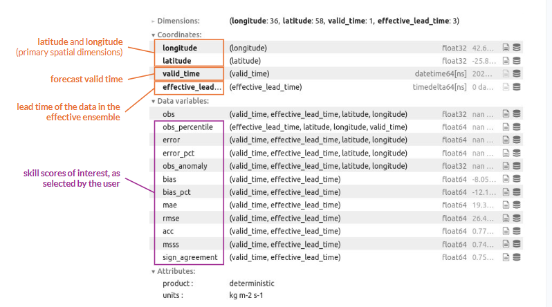
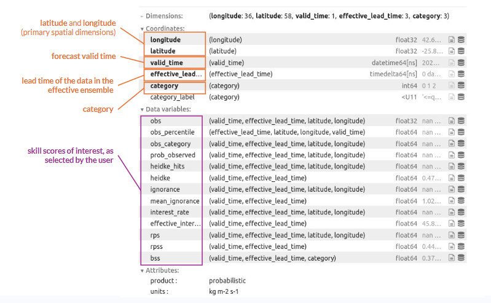

Forecast Verification
=====================

.. important::
    This is a tool being developed by the ACACIA project. Please email feedback to joshua.talib@ecmwf.int.

For verification of deterministic and probabilistic products, you will need to use the *verify_deterministic* and *verify_probabilistic* functions.  Each function uses `xskillscore <https://xskillscore.readthedocs.io/en/stable/#>`_, a Python library used to derive metrics for verifying forecasts.  

Verifying Deterministic Products
--------------------------------

To import the necessary functions, use the following line of python code:

.. code-block:: python
    
    from acacia_s2s_toolkit.verify_deterministic import verify_deterministic

After this, use *verify_deterministic* as follows:

.. code-block:: python

   verify_deterministic(product, obs, # forecast and observations
		        scores=None) # skill metrics 

:Parameters:

- **product**: the forecast product produced by the function ``make_deterministic_product``

- **obs**: (valid_time, lead, latitude, longitude) the observations being used to verify the forecast product.  Observations are aligned to the forecast during earlier postprocessing.

- **scores** (optional, [list of *str*]): which skill score(s) you want to use.  If this is not specified, the toolkit defaults to including all available skill scores.

Some skill scores vary across the spatial domain and can be plotted on a map, while others are represented by a single value for the whole domain.  Scores that are displayed on a map (valid_time, lead, latitude, longitude) are:

  - ``'obs'``: the observations the forecast is being verified against
  - ``'obs_percentile'``: the observation as a percentile (0-100) of the hindcast period obs stored in the product, at that grid point and lead time (hindcast values equal to the obs count half)
  - ``'error'``: How much the forecast differs from observations (fcast_mean - obs)
  - ``'error_pct'``: the error as a percentage of the climatology ((100 x fcast_mean - obs) / clim_obs).  Relative to the climatology rather than the observed value, which can be 0 (e.g. a dry week); NaN where the climatology is 0 or negative
  - ``'obs_anomoly'``: obs - clim_obs, to plot next to fcst_anomaly
    
  Scores that are spatially aggregated into a single value (valid_time, lead) are:
  
  - ``'bias'``: mean error
  - ``bias_pct'``: percent bias i.e. 100 x mean error
  - ``'mae'``: mean absolute error
  - ``'rmse'``: root-mean-square error
  - ``'acc'``: anomoly correlation i.e. correlation over the entire map between forecast and observed anomolies (centred, i.e. spatial means removed)
  - ``'msss'``: mean-squared skill score of the anomalies against climatology.  0 = no better than climatolgy; 1 = perfect
  - ``'sign_agreement'``: fraction of the area where the forecast and observed anomalies have the same sign (0.5 = chance for a symmetric variable)
  
The *verify_deterministic* function outputs data as an *xarray.Dataset* with the following structure:

   
Image: example of an *xarray.Dataset* containing output of the *verify_deterministic* function.  Label key: main data dimensions (orange), data coordinates (blue), data variables (purple)

Verifying Probabilistic Products
--------------------------------

To import the necessary functions, use the following line of python code:

.. code-block:: python
    
    from acacia_s2s_toolkit.verify_probabilistic import verify_probabilistic

After this, use `verify_probabilistic` as follows:

.. code-block:: python

   verify_probabilistic(product, obs, # forecast and observations
		        scores=None) # skill metrics 
		          
:Parameters:
	     
- **product**: the forecast product produced by the function ``make_probabilistic_product``

- **obs**: (valid_time, lead, latitude, longitude) the observations being used to verify the forecast product.  Observations are aligned to the forecast during earlier postprocessing.

- **scores** (optional, [list of *str*]): which skill score(s) you want to use.  If this is not specified, the toolkit defaults to including all available skill scores.

Some skill scores vary across the spatial domain and can be plotted on a map, while others are represented by a single value for the whole domain.  Scores that are displayed on a map (valid_time, lead, latitude, longitude) are:

  - ``'obs'``: the observations the forecast is being verified against
  - ``'obs_percentile'``: the observation as a percentile (0-100) of the hindcast period obs stored in the product, at that grid point and lead time (hindcast values equal to the obs count half)
  - ``'obs_category'``: index of the observed category
  - ``'prob_observed'``: probability the forecast gave to the observed category
  - ``'heidke_hits'``: Measures whether the forecast correctly identified the category that actually occurred, giving full credit for a correct forecast and partial credit when multiple categories were equally likely. = 1 if the most probable category was observed, = 0 if not; with ties 1/n for each of the n tied categories (e.g. 0.5 for two)
  - ``'ignorance'``: how wrong the forecast probabilities were for the outcome that occurred.  -log2(probability of the observed category), in bits; lower is better (climatology for terciles: log2(3) = 1.58)
  - ``'interest_rate'``: how much better or worse the forecast probabilities performed compared with simply relying on climatology, expressed as the return on a bet placed on the forecast probabilities against odds set by climatology (0 = no gain, 100 = money doubled, -100 = all lost).  100 x (p_obs / clim_obs - 1), in %
  - ``'rps'``: fair ranked probability score (lower is better)
  
  Scores that are spatially aggregated into a single value (valid_time, lead) are:
  
  - ``'heidke'``: Heidke skill score, measures how often the forecast correctly identified the observed category, compared with what would be expected from climatology.  (H - E) / (1 - E), H = area fraction of hits (heidke_hits), E = hits expected by chance = climatological probability of the forecast category (1/3 for terciles); 0 = chance, 1 = perfect, negative = worse than chance
  - ``mean_ignorance'``: area mean of ignorance
  - ``'effective_interest_rate'``: (see ``'interest_rate'`` above) the average return over the map (geometric mean, as compounded interest), in % = 100 * (2^(mean ignorance of climatology - mean ignorance) - 1)
  - ``'rpss'``: Ranked probability skill score.  1 - mean(RPS) / mean(RPS of climatology)
  - ``'bss'``: Brier skill score.  Per category: 1 - mean(BS) / mean(BS of climatology) of the event "obs in this category" (fair Brier score)
  
The *verify_probabilistic* function outputs data as an *xarray.Dataset* with the following structure:

   
Image: example of an *xarray.Dataset* containing output of the *verify_probabilistic* function.  Label key: main data dimensions (orange), data coordinates (blue), data variables (purple)

